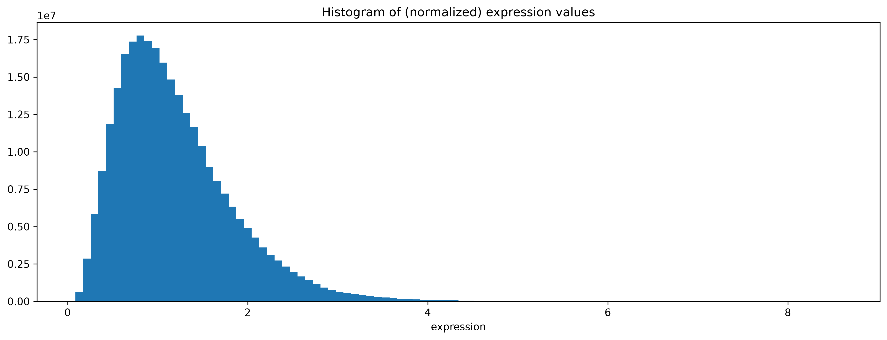
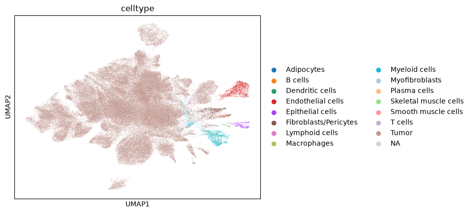
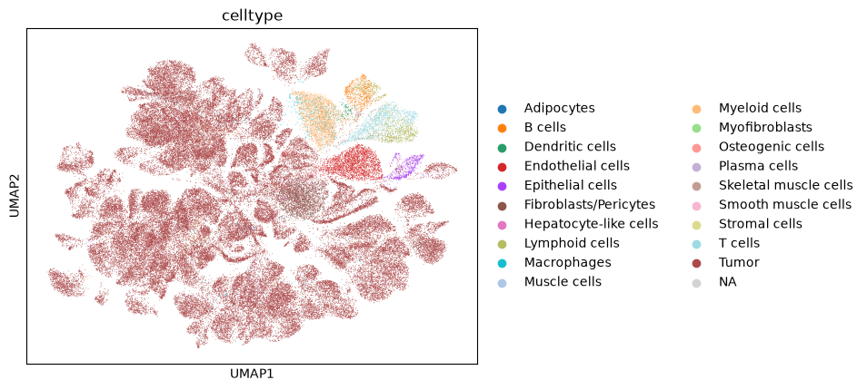
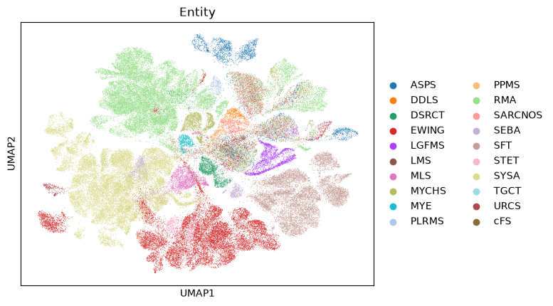

# Practice with python packages

## Scripts
|Script | Comments|
|-----|---------|
|00_test.ipynb| test out packages and conda env|
|01_practice_anndata.ipynb| test out example adata file (SySa) |
|02_practice_scanpy.ipynb| scanpy legacy workflow (processing and clustering 3k PBMCs) |
|03_downsample.py| downsample the big adata file for easier use |
|04_downsample.py| downsample the big adata file for easier use |

## adata files
- big adata: `data/scvi_pools_2026_celltype_annotated.h5ad`.  
    - 481,411 (cells/barcodes) × 35,929 (genes/transcripts). 
    - Entity: RMA, EWING, URCS, SYSA, MYE, SFT, SEBA, ASPS, MLS, LGFMS, PLRMS, MYCHS, DDLS, LMS, PPMS, STET, cFS, DSRCT, TGCT, SARCNOS
    - Fusion: PAX7::FOXO1, PAX3::FOXO1, NCOA1::PAX3, FUS::ERG, YWHAE::NUTM2A, EWSR1::FLI1, EWSR1::ETV1, SS18::SSX1, EWSR1::POU5F1, NAB2::STAT6, SS18::SSX2, ASPSCR1::TFE3, DDIT3::FUS, CREB3L2::EWSR1, EWSR1::NR4A3, CREB3L2::FUS, NR4A3::SMARCA2, ETV6::NTRK3, EWSR1::WT1
- tumor example: `data/scvi_sysa_feb26.h5ad`.  
    - 112,903 (cells/barcodes) × 34,876 (genes/transcripts). 
    - Entity: SYSA
    - Fusion: SS18::SSX1, SS18::SSX2
- downsampled 20%: `data/scvi_pools_2026_downsampled_20per.h5ad`.  
    - 96,282 (cells/barcodes) × 35,929 (genes/transcripts). 


## Preprocessing

The files storing anndata objects (.h5ad) are pretty big and therefore hard to process. To actually work with them, it is sometimes necessary to work with job submissions. To run jobs on python scripts use: 
```bash
submit-job -m 250g -t 02:00:00 -c 10 -n scanpy_env -e experiment01 -j downsample_20per -s 04_downsample.py
```


#### Histogram of expression values

- downsampled 20%: `data/scvi_pools_2026_downsampled_20per.h5ad`.  



- tumor example: `data/scvi_sysa_feb26.h5ad`.  

- downsampled 20%: `data/scvi_pools_2026_downsampled_20per.h5ad`.  


