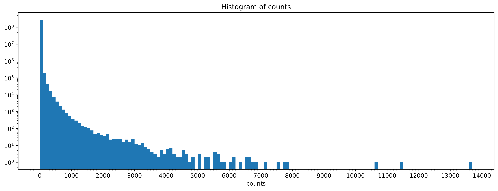

# Practice with python packages

## Scripts
|Script | Comments|
|-----|---------|
|00_test.ipynb| test out packages and conda env|
|01_practice_anndata.ipynb| test out example adata file (SySa) |
|02_practice_scanpy.ipynb| try scanpy methods (normalization, clustering, umap, etc) |
|03_practice_scvi.ipynb| |
|04_downsample.py| downsample the big adata file for easier use |

to run jobs use: 
```
submit-job -m 400g -t 02:00:00 -c 10 -n scanpy_env -e experiment01 -j downsample_20per -s 04_downsample.py
```
## anndata

### adata files
- big adata: `data/scvi_pools_2026_celltype_annotated.h5ad`.  
    - 481411 (cells) × 35929 (genes). 
    - Entity: RMA, EWING, URCS, SYSA, MYE, SFT, SEBA, ASPS, MLS, LGFMS, PLRMS, MYCHS, DDLS, LMS, PPMS, STET, cFS, DSRCT, TGCT, SARCNOS
    - Fusion: PAX7::FOXO1, PAX3::FOXO1, NCOA1::PAX3, FUS::ERG, YWHAE::NUTM2A, EWSR1::FLI1, EWSR1::ETV1, SS18::SSX1, EWSR1::POU5F1, NAB2::STAT6, SS18::SSX2, ASPSCR1::TFE3, DDIT3::FUS, CREB3L2::EWSR1, EWSR1::NR4A3, CREB3L2::FUS, NR4A3::SMARCA2, ETV6::NTRK3, EWSR1::WT1
- downsampled: `data/scvi_pools_2026_downsampled_20per.h5ad`.  
    - 96282 (cells) × 35929 (genes). 
- tumor example: `data/scvi_sysa_feb26.h5ad`.  
    - 112903 (cells) × 34876 (genes). 
    - Entity: SYSA
    - Fusion: SS18::SSX1, SS18::SSX2

### expression values

adata: `data/scvi_pools_2026_downsampled_20per.h5ad`




method

### clustering

method

### cell information (obs)


### cell information (var)

## scanpy

## scvi-tools