# PBMC3k data set

This is the preperation of an example data set for further analysis.   
This includes QC, Normalization, Clustering and Annotation.

## Scripts
|Script | Comments|
|-----|---------|
|00_data.ipynb| create .h5ad file from 10x-Genomics-formatted mtx directory |
|01_qc_metrics.ipynb| add qc metrics to metadata |
|02_outliers.ipynb| define outliers based on qc metrics and remove them (scanpy approach vs mad approach)|
|03_Normalization.ipynb| log1p normalization (shifted logarithm) |
|04_Annotation_SCANPY.ipynb| clustering and annotation for scanpy approach |
|05_Annotation_MAD.ipynb| clustering and annotation for mad approach |
|06_adata_version.ipynb| make result readable for older versions of anndata (remove .uns) |

## Methods

For all steps these references were used:
- [scanpy legacy workflow](https://scanpy.scverse.org/en/stable/tutorials/basics/clustering-2017.html#)
- [single-cell best practices](https://www.sc-best-practices.org/)

My notes on the scanpy functions are here: [scanpy methods](Scanpy_methods.md)

## QC
### QC Metrics

With these metrics the goal is to filter low-quality cells. There are quite a lot of metrics that could be taken into account: 

- `n_genes_by_counts`: number of genes with (positive) counts in a cell 
- `total_counts`: total number of counts for a cell (library size)
- `pct_counts_mt`:  proportion of total read counts for a cell which are mitochondrial genes
- `pct_counts_ribo`:  proportion of total read counts for a cell which are ribosomal genes
- `pct_counts_hb`:  proportion of total read counts for a cell which are hemoglobin genes

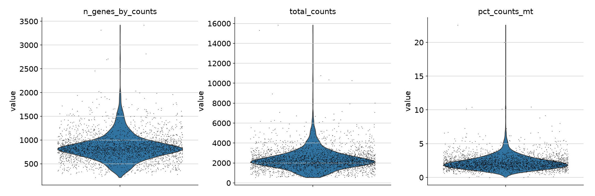
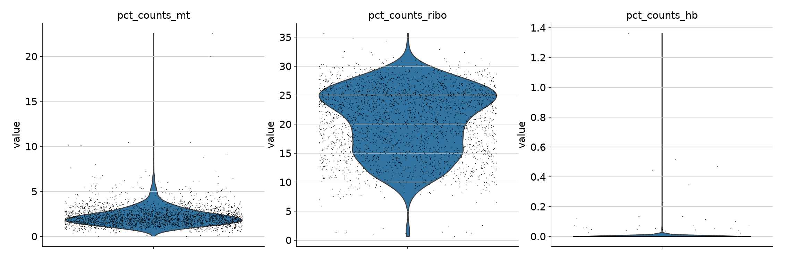

A more reliable way to determine the outliers, should be using metrics based on the log transformed counts:
- `log1p_n_genes_by_counts`
- `log1p_total_counts`

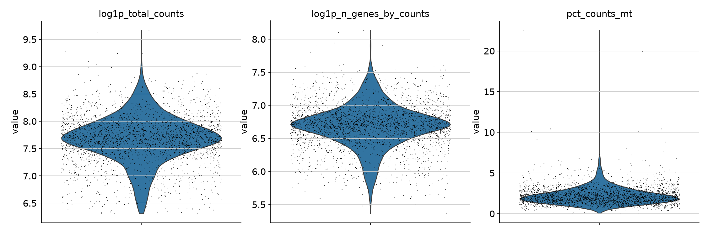

### Finding loq-quality cells 

I have used two different workflows to determine low-quality cells. The workflow suggested by [scanpy](https://scanpy.scverse.org/en/stable/tutorials/basics/clustering-2017.html#), and one that is in more in accordance to how it was explained in [single-cell best practices](https://www.sc-best-practices.org/preprocessing-visualization/quality-control/) which used the MAD (median absolute deviations) to define thresholds for the outliers.

#### Scanpy workflow

Metrics used: `n_genes_by_counts`, `pct_counts_mt`

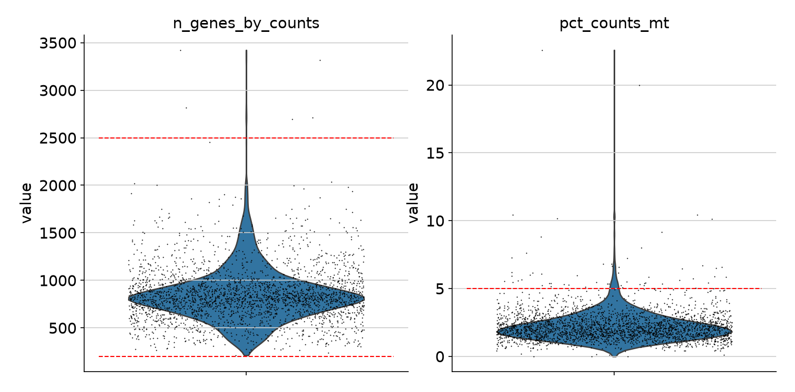
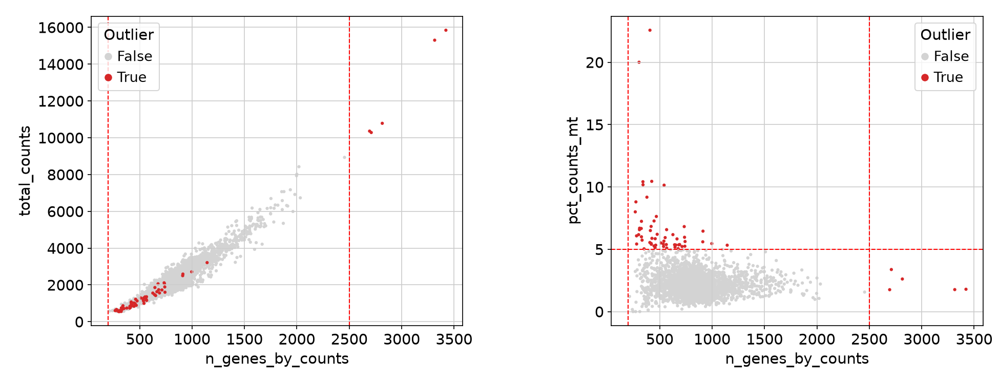

#### MAD workflow

Metrics used: `log1p_n_genes_by_counts`, `pct_counts_mt`  

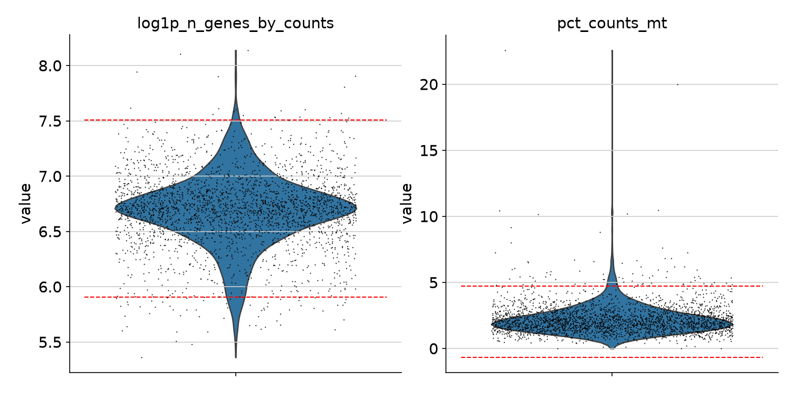
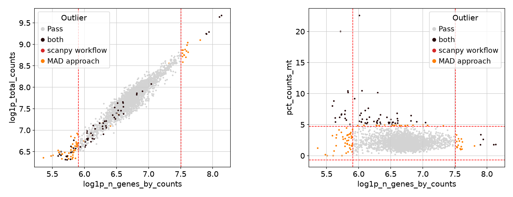

## Normalization

To normalize the read counts, TP10K normalization and shifted logarithm (log1p) was used.

- scanpy workflow
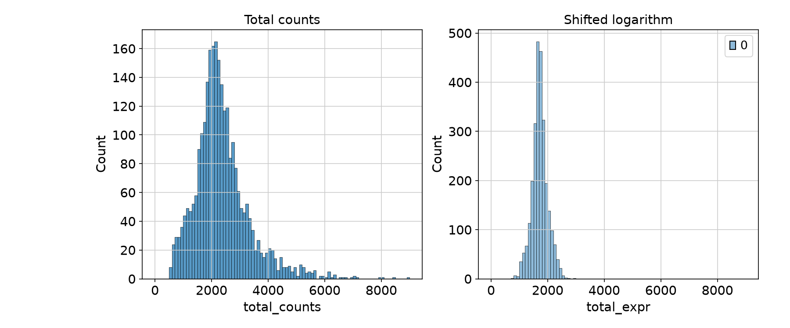
- mad workflow
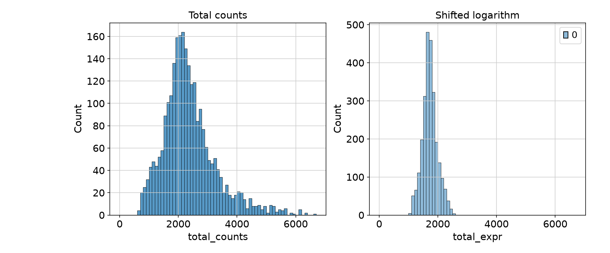

## Clustering

| Workflow | number PCs | resolution | clusters | umap |
| --- | --- | --- | --- | --- |
| scanpy | 40 | 0.7 | 8 | 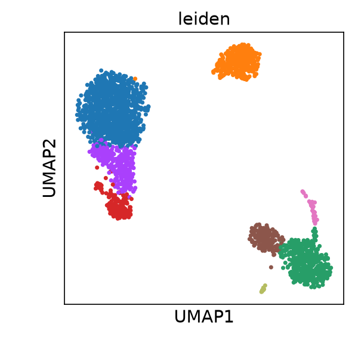 |
| scanpy | 10 | 0.3 | 8 | 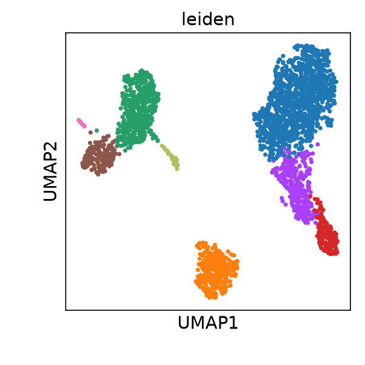 |
| scanpy | 10 | 0.7 | 11 | 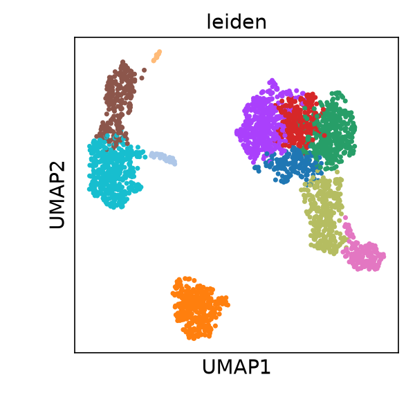 |
| mad | 10 | 0.35 | 8 | 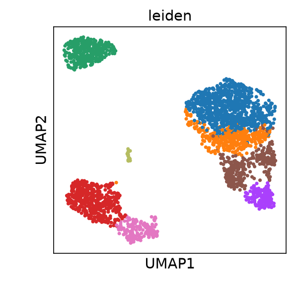 |
| mad | 10 | 0.3 | 7 | 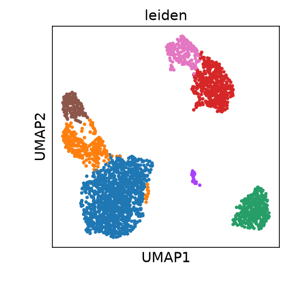 |
